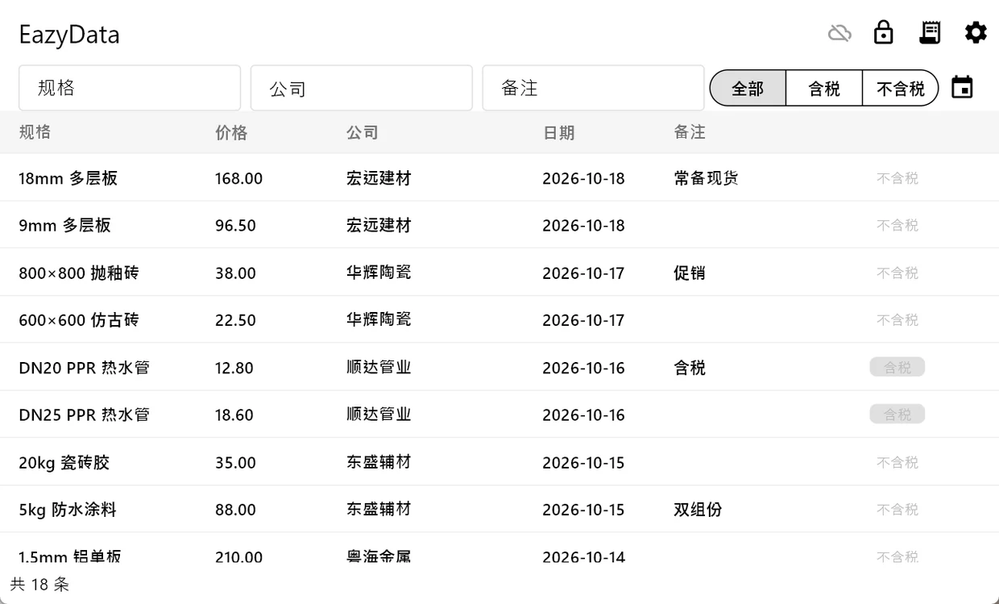

# EazyData Server

EazyData 的云同步服务端：**Node.js + Express + SQLite**，为 Windows / Android 双端提供本地优先（local-first）架构中的增量同步能力。

> 这是个人项目 EazyData 的服务端展示仓库，客户端界面与业务数据不包含在本仓库。



## 特性

- **增量拉取**：客户端携带上次同步的 `updated_at` 时间戳，服务端只返回之后的变更。
- **后写者胜（last-write-wins）**：以 `updated_at` 比较版本，旧写入不会覆盖新数据。
- **软删除**：删除只写入 `deleted = 1`，同步完成后由客户端物理清理本地行。
- **金额整数存储**：价格以「分」为单位存 `INTEGER`，避免浮点误差。
- **Bearer token 鉴权**：固定 token 访问同步接口，适合个人 / 小团队场景。
- **零外部数据库**：使用 Node.js 内置 `node:sqlite`，单文件数据库即可部署。

## API

| 方法与路径 | 鉴权 | 说明 |
|---|---|---|
| `GET /api/health` | 无 | 健康检查，返回 `{ ok: true }` |
| `POST /api/sync/pull` | Bearer | 按 `since` 时间戳拉取变更：`{ since, items, server_time }` |
| `POST /api/sync/push` | Bearer | 批量推送本地变更，返回 `{ saved, rejected }` |

数据行字段：

```text
id TEXT, spec TEXT, price_cents INTEGER, company TEXT, remark TEXT,
date TEXT, created_at INTEGER, updated_at INTEGER, deleted INTEGER, taxed INTEGER
```

## 运行

需要 Node.js 22.5+（`node:sqlite`）。

```bash
npm ci
EAZYDATA_TOKEN=dev-token PORT=3000 DB_PATH=./data.db npm start
```

环境变量：

| 变量 | 默认值 | 说明 |
|---|---|---|
| `PORT` | `3000` | HTTP 监听端口 |
| `EAZYDATA_TOKEN` | `dev-token` | Bearer token，生产环境必须替换为强随机字符串 |
| `DB_PATH` | `./data.db` | SQLite 数据库文件路径 |

```bash
curl http://127.0.0.1:3000/api/health
# {"ok":true,"time":...}
```

## 测试

```bash
npm test
```

测试覆盖健康检查、增量同步、软删除、版本冲突、数据库迁移等用例。

## 部署

### Docker

```bash
docker build -t eazydata-server .
docker run -d --name eazydata \
  -p 3000:8080 \
  -e EAZYDATA_TOKEN=<token> \
  -e DB_PATH=/data/data.db \
  -v /var/lib/eazydata:/data \
  eazydata-server
```

### systemd

```ini
[Unit]
Description=EazyData Server
After=network.target

[Service]
WorkingDirectory=/opt/eazydata/server
Environment=PORT=3000
Environment=EAZYDATA_TOKEN=<token>
Environment=DB_PATH=/var/lib/eazydata/data.db
ExecStart=/usr/bin/node src/index.js
Restart=always
User=www-data

[Install]
WantedBy=multi-user.target
```

## 设计说明

客户端的所有增删改先写本地 SQLite 并立即响应，后台队列把 `dirty` 行推送至服务端；服务端按 `updated_at` 做后写者胜合并。拉取使用时间戳游标，避免全量传输。个人使用场景下冲突概率极低，因此没有引入 CRDT 或操作日志。

---

*仓库仅包含服务端代码与脱敏界面预览，不含任何真实业务数据。*
